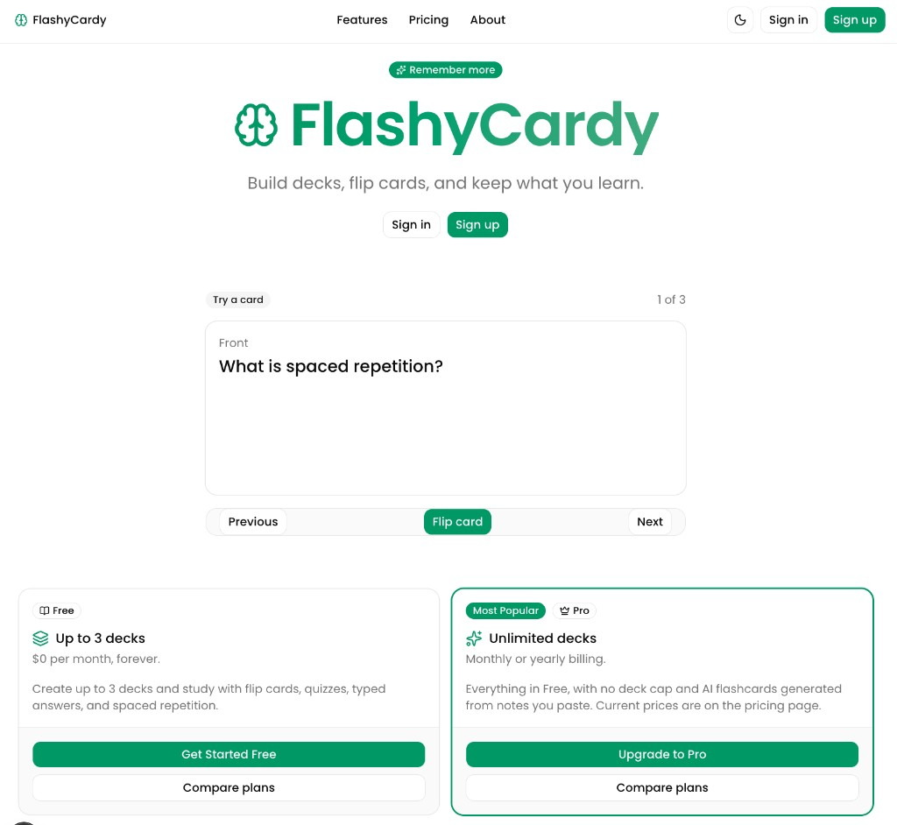

# FlashyCardy 🧠

Your personal flashcard platform: build decks, flip cards and remember more.

**Live demo:** [flashycardycourse-smoky.vercel.app](https://flashycardycourse-smoky.vercel.app)

> A learning project built by Akhil Gupta while learning vibe coding with [Cursor](https://cursor.com).



## Features

- **Authentication** with Clerk (sign in / sign up in a modal)
- **Decks and cards:** create, rename and delete decks; add, edit and delete cards (up to 20 cards per deck)
- **Study mode:** flip through cards and mark them as learned to track progress
- **AI flashcard generation** from a deck's title and description (Pro plan)
- **Subscription plans** via Clerk Billing:
  - Free: up to 3 decks
  - Pro: unlimited decks and AI generation
- **Shareable learning certificate** once you finish studying a deck
- **Per-user data isolation:** every query is scoped to the signed-in user, so you can only see your own decks and cards

## Tech stack

| Area | Technology |
| --- | --- |
| Framework | [Next.js](https://nextjs.org) 16 (App Router), React 19, TypeScript |
| UI | [shadcn/ui](https://ui.shadcn.com), Tailwind CSS 4 |
| Auth & billing | [Clerk](https://clerk.com) |
| Database | [Neon](https://neon.tech) Postgres + [Drizzle ORM](https://orm.drizzle.team) |
| AI | [Vercel AI SDK](https://ai-sdk.dev) + OpenAI |
| Validation | [Zod](https://zod.dev) |
| Hosting | [Vercel](https://vercel.com) |

## Getting started

### Prerequisites

- Node.js 20 or newer and npm
- A [Clerk](https://clerk.com) application with Billing enabled
- A [Neon](https://neon.tech) Postgres database
- An [OpenAI](https://platform.openai.com) API key

### Installation

```bash
git clone https://github.com/akhilguptapm/flashycardycourse.git
cd flashycardycourse
npm install
```

### Environment variables

Copy the example file and fill in your own values:

```bash
cp .env.example .env.local
```

| Variable | Description |
| --- | --- |
| `DATABASE_URL` | Neon Postgres connection string |
| `NEXT_PUBLIC_CLERK_PUBLISHABLE_KEY` | Clerk publishable key (safe for the browser) |
| `CLERK_SECRET_KEY` | Clerk secret key (server only) |
| `OPENAI_API_KEY` | OpenAI API key (server only) |

> **Note:** the Drizzle CLI (`drizzle.config.ts`) reads `DATABASE_URL` from a file named `.env`, while Next.js reads `.env.local`. Put `DATABASE_URL` in both, or run `cp .env.local .env`.
>
> Never commit real keys. `.env*` files are git-ignored (only `.env.example` is tracked).

### Clerk Billing setup

In the Clerk Dashboard, under Billing, create these (the slugs must match exactly):

| Type | Slug |
| --- | --- |
| Plan | `free_user` |
| Plan | `pro` |
| Feature | `3_deck_limit` (free) |
| Feature | `unlimited_decks` (pro) |
| Feature | `ai_flashcard_generation` (pro) |

### Database

Push the schema to your Neon database:

```bash
npm run db:push
```

### Run the app

```bash
npm run dev
```

Open [http://localhost:3000](http://localhost:3000).

## Scripts

| Command | Description |
| --- | --- |
| `npm run dev` | Start the development server |
| `npm run build` | Create a production build |
| `npm start` | Serve the production build |
| `npm run lint` | Run ESLint |
| `npm run db:generate` | Generate Drizzle migrations |
| `npm run db:migrate` | Apply migrations |
| `npm run db:push` | Push the schema directly (good for prototyping) |
| `npm run db:studio` | Browse the database with Drizzle Studio |

## Project structure

```text
src/
  app/                     # Routes
    dashboard/             # Deck list
    decks/[deckId]/        # Deck detail, cards and AI generation
    decks/[deckId]/study/  # Study mode
    pricing/               # Clerk pricing table
    certificate/[token]/   # Public shareable certificate
  components/              # shadcn/ui and shared components
  db/
    schema.ts              # Drizzle schema (decks, cards)
    queries/               # All database reads and writes live here
  lib/                     # AI config, billing, limits, helpers
  proxy.ts                 # Clerk route protection
```

### Architecture notes

- All database access goes through helpers in `src/db/queries/`; pages and actions never touch the database directly.
- Reads happen in Server Components; writes are Server Actions validated with Zod.
- The user ID always comes from Clerk's `auth()` on the server, never from client input.
- Plan limits and the AI feature are enforced on the server, not just hidden in the UI.

## Deployment

The app is deployed on [Vercel](https://vercel.com). To deploy your own copy:

1. Import the repository into Vercel.
2. Add the environment variables listed above in the project settings.
3. Add your Vercel domain to your Clerk application's allowed origins.

## License

Copyright (c) 2026 Akhil Gupta. All rights reserved.

This repository is public so you can read and evaluate the code, but it is **not open source**. Using, copying, modifying or distributing it requires a paid license. See [LICENSE](LICENSE) for details.

Interested in a license? Get in touch via [LinkedIn](https://www.linkedin.com/in/akhilgupta-pm).

## Author

Created by [Akhil Gupta](https://www.linkedin.com/in/akhilgupta-pm).
